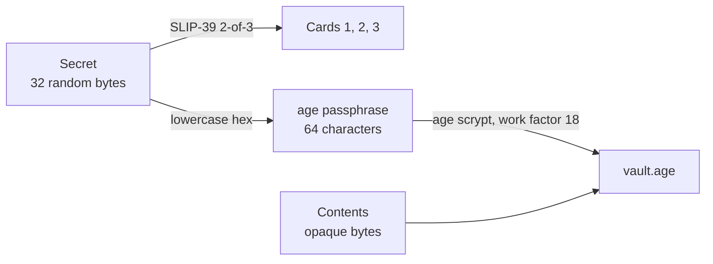

# Vault format

> **Draft v0, not frozen.** Written by Claude from the decisions in
> [docs/design.md](../docs/design.md) to go with the first vault code; it
> will be rewritten before spec v0 review. Nothing here is stable yet.

A Holvard vault is a plain [age](https://c2sp.org/age) file encrypted with
a passphrase, and the passphrase comes from a SLIP-39 secret split into
three cards. Any two cards open the vault, and so do the standard tools
alone: Trezor's `shamir` CLI and the official `age` CLI.



## Secret

- 32 bytes (256 bits) from the operating system's random generator.
- age encrypts the contents under its own random 128-bit file key, which
  the secret only wraps. The vault's security level is therefore that of
  age, 128 bits, not 256.
- Never derived from a password and never chosen by a person.
- A new vault always gets a new secret. Re-encrypting an existing vault
  under the same secret keeps its cards valid.

## Cards

The secret is the SLIP-39 master secret, split with these parameters:

| Parameter | Value |
|---|---|
| Groups | 1 (group threshold 1) |
| Members | 3, member threshold 2 |
| Passphrase | empty |
| Iteration exponent | 0 (the default of `shamir create`) |
| Extendable backup flag | set |
| Identifier | 15 random bits |

Each card is one SLIP-39 mnemonic of 33 words. Opening a vault takes
exactly two different cards (see "Reader rules").

The card's printed layout, QR code and any extra fields (format version,
vault fingerprint) are not specified yet.

## Vault file

- A binary (not armored) age v1 file with exactly one recipient stanza, of
  type `scrypt`.
- Passphrase: the lowercase hexadecimal encoding of the 32-byte secret, 64
  ASCII characters `0-9a-f`, with no prefix, separator or newline. This is
  the exact string `shamir recover` prints as "Your master secret is".
- scrypt work factor (`log2(N)`): 18 when writing, age's default.
- When reading, implementations must refuse work factors above 20, before
  doing any scrypt work. 20 is the highest the browser age library
  (typage) accepts.

## Reader rules

The tables above say how a vault is written. A reader opening a vault must
also refuse anything outside them, in this order, before doing the
expensive work:

1. **Header size.** The whole age header, up to and including the newline
   that ends its MAC line (the line starting `---`), must fit in the first
   1024 bytes. A Holvard header is about 150 bytes; age
   header parsing can take seconds on a crafted header of several hundred
   kilobytes.
2. **Cards.** Exactly two cards, not the same card twice, and each must
   have: one group (group count 1, so group threshold 1), member threshold
   2, iteration exponent 0 and a 256-bit secret. The extendable flag may be
   either value. This is checked before SLIP-39 decryption, whose PBKDF2
   cost is set by the cards themselves: exponent 15 would cost 2^15 times
   the normal work.
3. **Vault file.** A binary age v1 file with a single `scrypt` stanza and a
   work factor of at most 20. An armored file (`age -a`), or one encrypted
   to any other kind of recipient, is not a Holvard vault, and readers
   should say so rather than blame the cards.

## Contents

The age payload is opaque bytes. This draft defines no structure inside
it; packing several documents, a vault version or a date is left to a later
version of this spec and will be added without changing the layers above.

## Memory hygiene

Implementations should wipe the secret, the passphrase and the opened
contents from memory when done. Holvard's own code does; some buffers inside
the age and scrypt libraries it uses are freed without wiping (see the note
at the top of `crates/holvard-core/src/vault.rs`).

## Recovery with standard tools

```sh
shamir recover            # type two cards; prints the secret as hex
age -d vault.age > contents
                          # at the prompt, type the hex secret
```

Non-interactively, with `age-plugin-batchpass` (age 1.3 or later). Keep
the secret out of the command line, so it does not land in the shell's
history: save it to a file first, and remove the file afterwards.

```sh
AGE_PASSPHRASE_FD=3 age -d -j batchpass vault.age > contents 3<secret.hex
```

## Test vector

[test-vectors/vault/](../test-vectors/vault/) holds a vault made only with
the official tools. Every implementation must open it with any two of its
cards.
